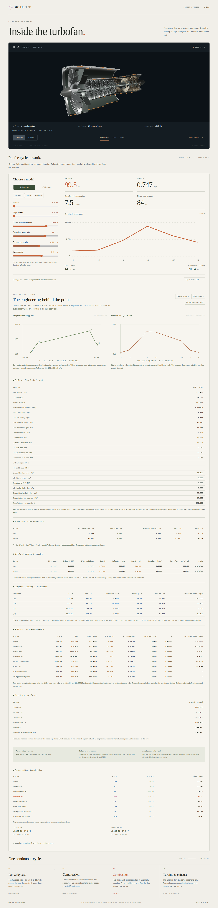
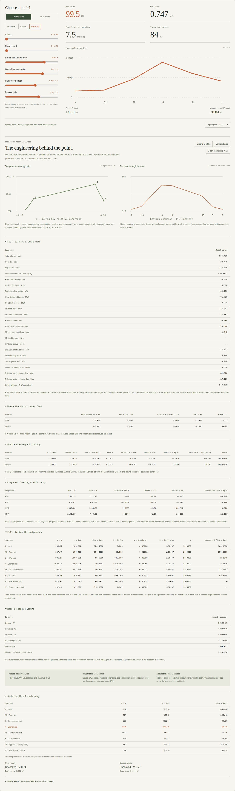

# Inside the turbofan

An orbitable, procedural two-spool turbofan cutaway with a thermodynamic
cycle workbench and a public-data JT9D ground profile, authored in Go and GSX. No external model, downloaded texture, custom
shader, or application JavaScript is required.



From the repository root:

```sh
GOWORK=off go run ./cmd/gosx build --prod examples/turbofan
PORT=8080 examples/turbofan/dist/run.sh
```

Open <http://localhost:8080>. A development build also works; replace `--prod`
with `--dev`. The `build.goWASM` configuration compiles the cycle engine and
stages it with content hashes, Brotli/gzip compression and the matching Go
loader alongside the framework runtime assets. After a build,
`GOWORK=off go run ./examples/turbofan` runs the source application too.

Drag to orbit and scroll or pinch to zoom. Camera and casing buttons update the existing scene locally, with no page
navigation or application data requests. Casing changes preserve the camera and
rotor clock. Pause freezes the current pose; resume continues from that pose.
Browser Back/Forward restores camera and casing choices.
The framework also honors the browser's reduced-motion preference.

Select **JT9D maps**, or open `/?model=jt9d`, for the mapped ground profile.
Five NASA component maps solve spool speeds, airflow split and operating points
against fixed nozzles. Rated thrust/fuel and published pressure/bypass ratios
anchor the cycle; approach and idle fit two declared efficiency corrections.
Idle uses bounded engineering extensions of the public map boundaries. All five
maps are plotted, with dashed modeled regions and explicit operating-point flags.
Climbout remains excluded from fitting, with −0.55% reference-thrust error.

The fuel slider and presets beside the 3D viewer drive the same solver as the
workbench controls. Both spools follow solved N1/N2 at a common 1/800 speed
reduction. Studio materials are the default. The optional **Gas temperature tint** button
shows a schematic diagnostic; it does not calculate metal temperature. Fuel changes
preserve rotor pose, pause, camera, canvas and geometry buffers. The numerical
model remains steady; it does not calculate shaft acceleration, metal temperature
or three-dimensional flow. CSV exports include low-speed assumptions and map
region flags.

The studio finish uses neutral key/fill/rim lighting, a small generated reflection
map, brushed titanium and steel, a painted casing, warm alloy and matte ceramic.
Two shared normal/roughness maps add subtle brushing and circumferential machining.
The three PNGs total 3908 bytes and are generated by repository-owned Go code:

```sh
GOWORK=off go run ./examples/turbofan/materials
```

The environment is an illustrative LDR studio reflection, not a measured or
prefiltered HDR probe. Finish choices are not measured JT9D optical properties.
The diagnostic can also be enabled initially with `?model=jt9d&thermal=gas`.
Surface changes retain the original geometry, mesh count and resident buffers.

The engineering inspector adds full station h/s/cp/γ, cooling states, signed component
power, estimated torque, thrust and energy ledgers, sonic nozzle thresholds and seven
individual matching residuals. Temperature–entropy and pressure diagrams follow the
current point. An 81-point model operating line shows thrust, spool-speed fractions,
OPR and TSFC, with sampled fuel sensitivities. Export the point's unrounded engineering
quantities or the complete model sweep to CSV. Tables can be expanded or collapsed.

The **Public RPM & station checks** section compares the frozen model with
FAA E3NE revision 16 speed limits, a university's -7R4D exhibit specifications,
and NASA's earlier -7A combustor-inlet references. It currently exposes a speed
scaling discrepancy: rated N1 is 3943.96 rpm, above the standard -7R4D limit
of 3770 rpm and -7R4D1 limit of 3810 rpm. Staying below an RPM maximum does
not establish measured-speed accuracy. The live limit rows follow fuel changes.

At the exhibit's stated 33.3 C and 213.5 kN uninstalled thrust, a separate
matched point overpredicts combustor-outlet temperature by 3.60% and turbine-inlet
temperature by 6.84%, and exceeds reported speed bounds. No parameters are
refitted. This is a qualified specification comparison with an assumed station
mapping, not instrumented validation. Nominal idle RPM has no complete
fuel/ambient/bleed condition; NASA -7A references are marked as a variant
mismatch. Source PDF hashes, locations, unit conversions and gaps are retained in
[the source record](cycle/data/public_validation.json) and
[the generated audit](calibration/public-validation.json).

```sh
GOWORK=off go run ./examples/turbofan/calibration --validate-public
```

This emits the comparisons as JSON and currently exits 1 because the public
speed checks fail. It cannot be combined with `--fit`. No matched measured
RPM/station points with complete operating conditions were identified; the
new audit does not make the model validated for these quantities.

NASA map shapes are scaled to the ICAO JT9D-7R4D / -7R4D1 entry, UID 1PW026.
They are not proprietary manufacturer maps. Temperature-dependent frozen-air
properties, cooling and other priors remain approximations. Calibration is
sparse and limited to sea-level static conditions, with no flight, station,
RPM or surge-margin validation. The generic mode retains its independent
cycle design controls. [Sources and reproducible import](cycle/data/SOURCES.md).

```sh
GOWORK=off go run ./examples/turbofan/calibration --fit
```

The cycle workbench solves both streams, burner energy, two shaft power
balances and convergent nozzles with choking and pressure thrust. Six sliders
change flight conditions and design inputs. Results, station temperatures,
pressures and flows update locally in the dedicated Go/WASM engine without
requests or navigation. Export a point to CSV with inputs, assumptions and
unrounded results. Sea-level and cruise presets change flight conditions;
Reset all restores the design. Infeasible combinations clear the results.

The **Cycle design** mode is a generic design-point calculator for cycle trends and energy
accounting. Constant gas properties and prescribed corrected airflow and
efficiencies are explicit assumptions. Nozzle areas resize at each point.
That generic mode has no real-engine calibration or map matching. Neither mode
provides surge prediction, CFD or transient shaft dynamics. Generic design-mode rotor speeds remain illustrative; mapped-mode speeds follow the solver.
See [equations, analytic benchmark and limits](MODEL.md).



The model includes a partial nacelle and intake lip, a spinner and 24 fan
blades, seven compressor rotor rows with six stationary stator rows, an
annular combustor with injectors, one high-pressure and three low-pressure
turbine rows, concentric shafts, an exhaust duct, and a tail cone. The fan
and low-pressure turbine share `low-spool`; the compressor and high-pressure
turbine share `high-spool`. Generic-mode angular velocities are 0.48 and 0.82 rad/s. Mapped-mode
angular velocities are solved RPM × 2π / 60 / 800. Displayed shaft RPM remains
unvalidated against independent engine-speed measurements.

Lathe profiles form the casings. Sampled, twisted airfoil surfaces are combined
into one indexed `BufferGeometry` per blade row: 498 blades in 18 row meshes,
about 48,000 triangles overall. This preserves custom airfoils without relying
on the primitive-only `InstancedMesh` path. Stable IDs and retained `Group.Spin`
boundaries keep the entire rotor assemblies on their shared shaft axis.
Both casing halves stay resident in 88 meshes: the cutaway draws 78 and
the exterior draws 76. Switching casing only changes visibility. SceneIR is
about 3.0 MB before HTTP compression. The scene caps rendering at 30 FPS,
1.5 DPR, and 921,600 backing pixels.

The geometry does not represent a particular manufacturer's engine or the
cycle solver's calculated nozzle areas. The front half of the nacelle and
core casing is omitted in cutaway mode. Stage proportions and motion are
chosen for clarity.

Validation:

```sh
GOWORK=off go test ./scene/... ./examples/turbofan/...
GOWORK=off go vet ./examples/turbofan/...
GOWORK=off go run ./cmd/gosx check examples/turbofan/app/page.gsx
GOWORK=off go run ./cmd/gosx size examples/turbofan/dist/build.json
```

With Playwright installed, run the browser checks against the running build:

```sh
SCENE3D_TOOLS_DIR=/path/containing/node_modules \
SCENE3D_BROWSER=/path/to/chromium \
node examples/turbofan/verify.mjs http://127.0.0.1:8080
```

The harness checks native/WASM numerical agreement, keyboard/slider/touch
input, CSV contents, infeasible-state recovery, a server-calculated fallback,
visible motion, pause/resume at the current pose, casing and camera controls
without navigation or application data fetches, document/canvas identity, Back/Forward,
pointer orbit, wheel zoom, query fallbacks, mobile fit, reduced motion, and
WebGPU selection or an explicit WebGL fallback. Engineering checks compare
shaft torque, heat input, nozzle discharge and the pre-mixing HPT outlet against
native results, exercise all tables and plots, and inspect both raw CSV exports.
Framework telemetry POSTs are reported separately. It writes the documentation
previews and local `evidence/` captures with a source-hashed JSON receipt.
It is test tooling and is never served as application code.

The retained [browser receipt](verification.json) identifies the tested source
by SHA-256; [mobile capture](mobile-preview.png). On this Linux software GPU,
WebGPU lost its device and recovered visibly through WebGL2. Native WebGPU
visual parity and hardware GPU frame rates remain unverified. The TinyGo
production build succeeded without the optional `wasm-opt` optimization.
The viewer prefers WebGL by default; `?backend=webgpu` opts into WebGPU.

For a software-rendered browser, the example's engineering budget provides
delivery and load checks:

```sh
GOWORK=off go run ./cmd/gosx perf --coverage --budget examples/turbofan/perf-budget.json \
  --budget-profile turbofan-engineering 'http://127.0.0.1:8080/?model=jt9d&backend=webgl'
```

The studio-material build measured 1637.75 KiB transferred with a fresh client
and warm server, 5.36 KiB above the previous 1632.40 KiB public-reference capture.
The existing local allowance remains 1640 KiB. The shared documentation profile
remains unchanged; its 1615 KiB network allowance is exceeded by 22.75 KiB. Browser load
and blocking time are checked separately, and software rendering does not
establish hardware GPU performance. See [the engineering inspector](engineering-preview.png).

The lathe generator regression test also covers the surface gap found while
building this example: each sampled quad must contain two non-overlapping
triangles sharing a diagonal, with every boundary edge present once.
